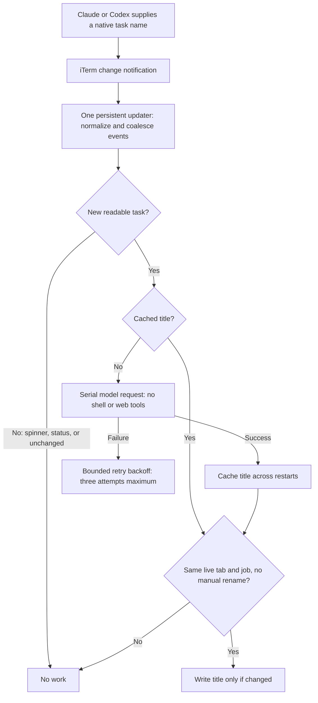

# Terminal TLDR

Three emojis and a short task title for Claude/Codex tabs in iTerm2.

## How it works



**The updater sleeps between events.** Cached names need no model request;
ordinary agent activity needs no title rewrite. It never scans transcripts or Git.

One persistent Python process subscribes to iTerm's native task-name, foreground
job and layout notifications. Claude and Codex already supply the task name.
Spinner/Working/Ready and blinking Action Required changes are ignored. UUIDs
and generic profile names aren't treated as tasks. Notifications are coalesced, and
unchanged titles cause no API writes. There is no repeating polling timer.

A new readable name gets one ephemeral GPT-5.6-Luna/max request. Requests run
serially, time out after 90 seconds, and are cached across restarts. Failures
back off for 5 then 10 minutes, with at most three attempts per name. Identical
names share a cache entry. A native name change can produce a new title; ordinary
agent activity cannot. Manual tab renames win until the foreground job changes.
Shell/execution tools and web search are disabled for the title request. The
service holds a single-instance lock and runs at background scheduling priority.

No transcripts, ledger, Git commands, terminal contents, process inspection,
agent hooks, broad directory scans, or per-tab Python subprocesses are used.
Untitled/unsupported jobs are left alone. The native name remains visible while
a title is generated. Closing a tab drops queued work; an already-running request
may finish into the cache, but cannot rename a closed/reused tab.

The daemon never launches/closes/restarts terminal sessions or sends them input.
It writes only tab titles and two ownership variables. Its own ephemeral model
process group is killed on timeout, cancellation or normal service shutdown;
it never signals your interactive agents. Only `install` manages the LaunchAgent.

## Commands

Enable **iTerm Settings → General → Magic → Enable Python API**, then:

```sh
./bin/terminal-tldr install
./bin/terminal-tldr status
python3 -m unittest discover -s tests -v
```

`status` is an on-demand local query reporting CPU time, peak memory, events,
model calls (including completed child CPU/peak memory), cache I/O and actual
title writes. It does not poll in the background.

### Opt-in live verification

```sh
~/.terminal-tldr/venv/bin/python scripts/verify_live.py
```

This opens a guarded, disposable window, immediately restores the previously
focused window and minimizes the fixture. A private pipe controls its fake native
task names; it never reads keyboard input. The test checks cached and real model
generation, spinner/status noise, genuine task changes, manual renames, warm
restart and preservation of every pre-existing session/foreground PID. It closes
only its own window and removes only its fixture cache entries. Local JSON
evidence goes under `~/.terminal-tldr/performance/YYYY-MM-DD/v2/`.

Files:
- `lib/titles.py`: bounded cache (8 KB/file, 512 in-memory entries), title generation.
- `iterm2/terminal_tldr_iterm.py`: event subscriptions and serial request queue.
- `bin/terminal-tldr`: installer/status; legacy hook calls are silent no-ops.
- `~/.terminal-tldr/titles-v2/`: small independent cache records, atomically written.
- `~/.terminal-tldr/service.log`: connection and request/failure logs.

The old `state.json` and title files are no longer read or updated. They are left
in place as a rollback archive, not deleted. No changes to the session ledger's
logging behavior are required; its redundant Terminal TLDR sidecar was removed.

To pause only this updater (existing titles and terminals stay intact):

```sh
launchctl bootout gui/$(id -u)/com.jacobbartlett.terminal-tldr-iterm
```

Use `install` to resume. A normal launchd restart or login starts the configured
service again; the Python API must remain enabled. To retry an exhausted title,
remove only its corresponding cache JSON while the service is stopped.
